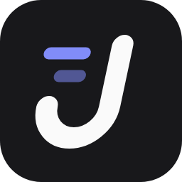

# Julie

Hafif ve hızlı bir web tarayıcısı. Rust ile yazıldı ve Windows'un yerleşik
Chromium motoru **WebView2**'yi kullanıyor.

## Neden hafif?

- **Motoru biz taşımıyoruz:** WebView2 Windows 10/11'de zaten yüklü ve
  Microsoft tarafından güncel tutuluyor. Uygulama birkaç MB.
- **Direct2D arayüz:** Sekmeler, butonlar ve kenar çubuğu doğrudan ekran
  kartıyla çizilir. Arayüz için web sayfası, yani ek bir renderer süreci yok.
- **Gömülü başlangıç sayfası:** Yeni sekme programın içinden gelir, ağdan
  hiçbir şey indirmez ve anında açılır.
- **Dahili reklam ve izleyici engelleyici:** Reklam ve izleme istekleri ağa
  hiç çıkmadan durdurulur; indirilmeyen betik CPU ve bellek de harcamaz.
- **Sekme uyutma:** Arka plandaki sekmeler önce düşük bellek moduna alınır,
  5 dakika sonra dondurulur (CPU sıfır), 30 dakika sonra bellekten tamamen
  atılır. Ses/video çalan sekmelere dokunulmaz.

## Gereksinimler

- Windows 10 veya 11
- [Rust](https://rustup.rs) (MSVC araç zinciri, `rustup default stable-msvc`)
- Visual Studio Build Tools ("C++ ile masaüstü geliştirme" bileşeni)
- WebView2 Runtime (Windows 11'de ve güncel Windows 10'da zaten yüklü)

## Çalıştırma

```bash
cargo run
```

Hız ve bellek ölçümü yaparken her zaman sürüm derlemesini kullanın:

```bash
cargo run --release
```

## Kullanım

| İşlem | Kısayol |
|---|---|
| Yeni sekme | `Ctrl+T` ya da `+` butonu |
| Sekmeyi kapat | `Ctrl+W`, `Ctrl+F4` ya da `✕` butonu (son sekme kapanınca tarayıcı kapanır) |
| Kapatılan sekmeyi geri aç | `Ctrl+Shift+T` |
| Sonraki / önceki sekme | `Ctrl+Tab` / `Ctrl+Shift+Tab` ya da `Ctrl+PgDn` / `Ctrl+PgUp` |
| 1.–8. sekmeye git | `Ctrl+1` … `Ctrl+8` |
| Son sekmeye git | `Ctrl+9` |
| Adres çubuğuna git | `Ctrl+L`, `Alt+D` ya da `F6` |
| Sayfaya dön | Adres kutusunda `Esc` |
| Yenile | `F5`, `Ctrl+R` ya da `⟳` |
| Geri / İleri | `Alt+←` / `Alt+→` ya da `←` `→` butonları |
| Yakınlaştır / uzaklaştır | `Ctrl` + `+` / `-`, `Ctrl` + fare tekerleği |
| Sayfada bul | `Ctrl+F` |
| Geliştirici araçları | `F12` ya da `Ctrl+Shift+I` |
| Yer imine ekle / çıkar | `Ctrl+D` ya da `☆` butonu |
| Geçmiş | `Ctrl+H` |
| Görünüm ve ayarlar | `Ctrl+,` |
| Sekmeyi kapat (fareyle) | Sekmede `✕` ya da orta tık |

## Görünüm

Arayüz Direct2D ve DirectWrite ile çizilir (`src/ui/`). Ayarlar sayfasından
(`Ctrl+,` ya da `julie://settings`) seçilebilir:

| Ayar | Seçenekler |
|---|---|
| Hazır temalar | Odak, Gece, Klasik, Minimal, Orman |
| Düzen | Kenar çubuğu (sekmeler solda), İnce şerit (ikonlar solda), Tek satır, Klasik |
| Renk modu | Açık, Koyu, Windows'a göre |
| Vurgu rengi | 6 renk ya da Windows'un vurgu rengi |
| Pencere tonu | Gri, Lavanta, Taş, Nane, Gökyüzü, Şeftali |
| Yoğunluk | Normal, Kompakt |

Hazır temalar: Odak (açık, lavanta), Gece (koyu, çivit), Klasik (açık,
nötr gri), Minimal (açık, taş, kompakt), Orman (koyu, yeşil). Varsayılan: Odak.

Butonlar Windows'un kendi ikon yazı tipiyle çizilir (Windows 11: Segoe
Fluent Icons, Windows 10: Segoe MDL2 Assets). Sekmelerde sitelerin kendi
ikonları görünür; ikonlar `places.sqlite`'ta saklandığı için uyuyan sekmeler
ve yer imleri de ikonlarıyla gösterilir. İkonu olmayan sitelerde küre ikonu
çıkar.
Başlık çubuğunun rengi temaya uyar; sayfalar ve sitelerin koyu tema
desteği seçilen renk moduna göre çalışır.

Yerleşim kodu platformdan bağımsızdır ve test edilir. Bütün düzenlerin SVG
önizlemelerini üretmek için:

```bash
JULIE_UI_PREVIEW=onizleme cargo test ui_previews -- --ignored
```

## Arama motoru

İlk açılışta başlangıç sayfası arama motoru seçtirir: Google, DuckDuckGo,
Bing, Brave Search, Startpage, Ecosia veya Yandex. Seçim daha sonra
başlangıç sayfasının altındaki menüden değiştirilebilir. Adres kutusuna alan
adı olmayan bir şey yazılırsa seçilen motorda aranır.

Ayarlar `%LOCALAPPDATA%\Julie\settings.ini` dosyasında, tarayıcı verileri
(çerezler, önbellek) `%LOCALAPPDATA%\Julie\WebView2` klasöründe tutulur.

## Bellek ve CPU ayarları

WebView2'ye başlangıçta verilen ayarlar (`src/browser.rs`, `BROWSER_ARGS`):

| Ayar | Etkisi |
|---|---|
| `--process-per-site` | Aynı sitenin sekmeleri tek süreci paylaşır; farklı siteler yine ayrı süreçlerde |
| `MediaRouter`, `DialMediaRouteProvider` kapalı | Ağda sürekli Chromecast arayan arka plan taraması durur |
| `AutofillServerCommunication` kapalı | Form bilgileri sunucuya gönderilmez (otomatik doldurma çalışır) |
| `msWebOOUI`, `msPdfOOUI` kapalı | Edge'in metin seçince çıkan mini menüsü |

## Güvenlik

**Zararlı site koruması (Microsoft SmartScreen)** varsayılan olarak açıktır ve
başlangıç sayfasından kapatılabilir. Açıkken ziyaret edilen adresler kontrol
için Microsoft'a gönderilir. Değişiklik açık sekmelere hemen uygulanır.

## Geçmiş ve yer imleri

Geçmiş ve yer imleri `%LOCALAPPDATA%\Julie\places.sqlite` dosyasında
(SQLite) tutulur.

- **Geçmiş** (`Ctrl+H` ya da `julie://history`): günlere göre gruplanmış
  liste, arama, tek tek silme ve "Geçmişi temizle". 90 günden eski kayıtlar
  açılışta silinir. Tek sayfalık sitelerde (YouTube'da video değiştirmek
  gibi) yeniden yükleme olmadan yapılan geçişler de kaydedilir.
- **Yer imleri** (`Ctrl+D` ya da adres çubuğunun yanındaki yıldız):
  başlangıç sayfasında kutucuklar olarak görünür, oradan silinebilir.

## Oturum

Tarayıcı kapanırken açık sekmeler `%LOCALAPPDATA%\Julie\session.txt`
dosyasına kaydedilir ve sonraki açılışta geri gelir. Yalnızca öndeki sekme
hemen yüklenir; diğerleri tıklanınca yüklenir, böylece çok sekmeyle bile
açılış hızlı olur. Oturum çalışırken de periyodik olarak kaydedilir
(beklenmedik kapanmada en fazla son 30 saniye kaybolur).

## Sekme uyutma

| Arka planda geçen süre | Ne olur |
|---|---|
| Hemen | Sekme gizlenir, WebView2 düşük bellek moduna alınır |
| 5 dakika | Sayfa dondurulur: betikler ve zamanlayıcılar durur, CPU kullanımı sıfıra iner. Geri dönünce anında açılır. |
| 30 dakika | Sayfa bellekten atılır, yalnızca adresi tutulur. Sekmeye tıklanınca yeniden yüklenir. |

Başlangıç sayfası 5 dakikada doğrudan bellekten atılır. Ses ya da video çalan
sekmeler hiç uyutulmaz.

Denemek için süreleri kısaltın (20 saniye / 1 dakika):

```powershell
$env:JULIE_FAST_SLEEP=1; cargo run --release
```

## Reklam engelleyici

Brave tarayıcısının kullandığı [adblock-rust](https://github.com/brave/adblock-rust)
motoruyla şu listeleri uygular:

| Liste | İçerik |
|---|---|
| [EasyList](https://easylist.to) | Reklamlar |
| EasyPrivacy | İzleyiciler |
| [uBlock filters](https://github.com/uBlockOrigin/uAssets) | uBlock Origin'in kendi kuralları (YouTube dahil) |
| uBlock filters – Privacy | Ek izleyici kuralları |
| uBlock filters – Unbreak | Engelleme yüzünden bozulan siteler için istisnalar |
| uBlock filters – Quick fixes | Hızlı düzeltmeler (YouTube kuralları sık güncellenir) |
| uBlock filters – Badware risks | Dolandırıcılık ve zararlı yazılım siteleri |

- İlk açılışta listeler arka planda indirilir (~6,5 MB), derlenip
  `%LOCALAPPDATA%\Julie\filters\engine-v2.dat` dosyasına kaydedilir.
  Sonraki açılışlarda kurallar bu önbellekten ~10 ms'de yüklenir.
- uBlock listelerindeki `!#if` / `!#include` yönergeleri işlenir
  (`src/filter_lists.rs`): yalnızca Chromium için geçerli kurallar uygulanır.
- Listeler 4 günden eskiyse arka planda yenilenir.
- Her istek ~2 µs'de kontrol edilir.
- **Betikler (scriptlet):** uBlock Origin'in betikleri sayfanın kendi
  kodundan önce enjekte edilir. YouTube'un video reklamları bu yolla
  engellenir: oynatıcıya giden veriden reklam alanları silinir.
- **Yönlendirmeler:** Bazı siteler izleme betiği hiç gelmezse bozulur. Bu
  durumda istek engellenir ama yerine uBlock'un zararsız sahte sürümü verilir
  (ör. sahte Google Analytics).
- **Kozmetik filtreler:** Engellenen reklamlardan kalan boş kutular da
  gizlenir. Sayfadaki küçük bir betik sınıf/kimlik adlarını toplar, tarayıcı
  yalnızca sayfada gerçekten bulunan adlara uyan gizleme kurallarını geri
  gönderir; sonradan eklenen reklamlar da yakalanır.
- Adres çubuğunun sağındaki buton o sayfada kaç isteğin engellendiğini
  gösterir. Butona tıklamak engelleyiciyi **o sitede** kapatır/açar (bozulan
  siteler için). Bu tercih ayarlara kaydedilir.
- Listeler indirilemezse buton "Liste indirilemedi" der; hatanın ayrıntısı
  `%LOCALAPPDATA%\Julie\julie.log` dosyasına yazılır.

## Logo

Koyu zemin üzerinde öne yatık beyaz bir J ve mor hız çizgileri.

| Dosya | Görevi |
|---|---|
| `assets/logo.svg` | Logonun kaynağı |
| `assets/julie.ico` | Uygulama ikonu (16–256 piksel); `build.rs` ile `julie.exe`'ye gömülür |
| `assets/logo-256.png` | Belgeler ve web için |

## Proje yapısı

| Dosya | Görevi |
|---|---|
| `src/main.rs` | Giriş noktası ve olay türleri |
| `src/browser.rs` | Pencere, sekmeler, olay döngüsü |
| `src/chrome.rs` | Arayüzün Windows tarafı: çizim, fare, adres kutusu, başlık çubuğu |
| `src/ui/theme.rs` | Görünüm ayarları, hazır temalar, renkler ve ölçüler (testli) |
| `src/ui/layout.rs` | Dört düzenin yerleşimi ve tıklama alanları (testli) |
| `src/ui/scene.rs` | Çizim listesi ve vektör ikonlar (testli) |
| `src/ui/d2d.rs` | Çizim listesini Direct2D/DirectWrite ile çizme |
| `src/ui/svg.rs` | Testler ve önizlemeler için SVG çizici |
| `src/settings_page.rs`, `src/settings_page.html` | Görünüm ayarları sayfası (testli) |
| `src/address.rs` | Adres çubuğu metnini URL'ye çevirme (testli) |
| `src/blocking.rs` | Filtre listeleri, kural derleme ve önbellek (testli) |
| `src/cosmetic.rs`, `src/cosmetic.js` | Kozmetik filtreler: sayfa betiği ve mesajlar (testli) |
| `src/filter_lists.rs` | Liste tanımları, `!#if`/`!#include` ön-işlemcisi (testli) |
| `src/scriptlet_injector.rs` | uBlock betiklerini sayfa kodundan önce enjekte etme |
| `resources/ubo-resources.json` | uBlock Origin betikleri ve yönlendirme kaynakları |
| `tools/build-ubo-resources.mjs` | Yukarıdaki dosyayı uBlock kaynak kodundan üretir |
| `src/request_filter.rs` | WebView2 isteklerini yakalayıp engelleyiciden geçirme |
| `src/places.rs` | Geçmiş ve yer imleri veritabanı (SQLite, testli) |
| `src/history_page.rs`, `src/history_page.html` | Geçmiş sayfası (testli) |
| `src/session.rs` | Oturum dosyası (testli) |
| `src/sleep.rs` | Sekme uyutma politikası (testli) |
| `src/shortcuts.rs` | Klavye kısayolu tablosu (testli) |
| `src/settings.rs` | Arama motorları ve ayar dosyası (testli) |
| `src/start_page.rs`, `src/start_page.html` | Gömülü başlangıç sayfası |

## Yol haritası

- [x] Klavye kısayolları
- [x] Dahili reklam ve izleyici engelleyici
- [x] Kozmetik filtreler
- [x] YouTube video reklamları (uBlock Origin betikleri)
- [x] Sekme uyutma
- [x] Bellek ve CPU için WebView2 başlangıç ayarları
- [x] SmartScreen tercihi
- [x] Geliştirici araçları (F12, ayrı pencerede)
- [x] Oturumu kaydetme ve tembel geri yükleme
- [x] Geçmiş ve yer imleri
- [ ] Adres çubuğu önerileri (geçmiş ve yer imlerinden)
- [ ] Yükleniyor göstergesi, geri/ileri butonlarının durumu
- [ ] Gizli pencere / ayrı profil
- [ ] Google Safe Browsing (SmartScreen yerine, gizlilik dostu)
- [x] Direct2D arayüz, 4 düzen ve tema seçenekleri
- [ ] Özel başlık çubuğu (pencere butonlarını arayüze katmak), Mica
- [x] Site ikonları (favicon)
- [ ] Sekmeleri sürükleyerek sıralama
- [ ] Tema dosyası yükleme/dışa aktarma
- [ ] Yerleşik geliştirici araçları (isteğe bağlı)
- [ ] Kurulum programı, otomatik güncelleme, kod imzası

## Lisans

Julie [GPL-3.0-or-later](LICENSE) lisanslı özgür bir yazılımdır.

Kullanılan üçüncü taraf bileşenler:

- [uBlock Origin](https://github.com/gorhill/uBlock) betikleri ve kaynakları
  (`resources/ubo-resources.json`), GPL-3.0-or-later, Raymond Hill ve
  katkıda bulunanlar.
- [adblock-rust](https://github.com/brave/adblock-rust), MPL-2.0, Brave.
- Filtre listeleri çalışma anında indirilir ve programa gömülmez:
  EasyList/EasyPrivacy (GPLv3 / CC BY-SA 3.0), uBlock filters (GPLv3).
